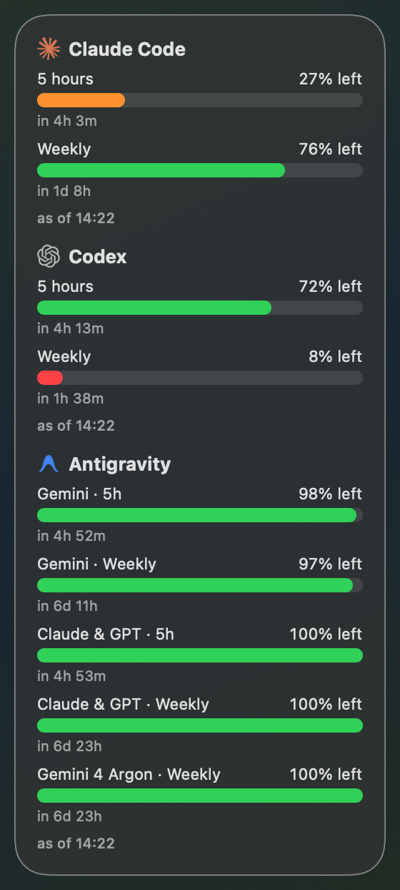

# Limits Widget

A macOS desktop widget that shows remaining subscription limits for AI coding agents (**Claude Code**, **Codex CLI**, and **Antigravity**) across 5-hour and weekly windows, with live countdowns until reset.



## Features

- Remaining limit percentage and progress bar for each window. Bar color: green (> 30% left), orange (10–30%), red (≤ 10%).
- Live countdown until reset (`in 3h 21m`). Hover over any row to see the exact reset date and time.
- Data freshness timestamp (`as of 10:17`, including date if older than today) and a `stale` indicator when a refresh fails.
- Clear status messages instead of blank space: `Not signed in`, `Sign in required — open Codex`, `No data`, `Network error`.
- Sits cleanly at desktop level without interfering with regular windows, draggable, and remembers its position.
- Menu bar icon with **Refresh**, **Settings…** (refresh interval, agent toggles, language selector), **Launch at login**, and **Quit**.
- **11 UI languages** (English default, plus German, Spanish, French, Italian, Norwegian, Icelandic, Finnish, Chinese Simplified, Japanese, and Russian) switchable live in Settings.

## Requirements

- macOS 14 Sonoma or newer.
- Swift 6: Xcode 16+ or Command Line Tools (`xcode-select --install`).
- Signed-in Claude Code, Codex CLI, and/or running Antigravity on this Mac. The widget reads their local state and never asks for your credentials directly.

## Installation

```bash
git clone https://github.com/DmitriyRud/limits-widget.git
cd limits-widget
scripts/bundle.sh                       # builds build/LimitsWidget.app
cp -R build/LimitsWidget.app /Applications/
open /Applications/LimitsWidget.app
```

macOS may prompt once for permission to read the `"Claude Code-credentials"` Keychain item — click **Always Allow**. Launch at login can be enabled from the menu bar (`.app` bundle only).

For development, you can also run without bundling: `swift run LimitsWidget`.

## Data Sources

| Agent | Credentials / Discovery (read-only) | Limits Source |
|-------|-------------------------------------|---------------|
| Claude Code | Keychain `"Claude Code-credentials"` via `/usr/bin/security` (fallback: `~/.claude/.credentials.json`) | `GET https://api.anthropic.com/api/oauth/usage` |
| Codex CLI | `~/.codex/auth.json` (`tokens.access_token`, `tokens.account_id`) | `GET https://chatgpt.com/backend-api/wham/usage` (fallback: latest session logs in `~/.codex/sessions`) |
| Antigravity | Local daemon metadata `~/.gemini/antigravity/daemon/hub_*.json` (`httpsPort`, `csrfToken`) | Local loopback RPC `POST https://127.0.0.1:<port>/exa.language_server_pb.LanguageServerService/RetrieveUserQuotaSummary` (fallback: `GetUserStatus`), no internet requests |

Data refreshes every 5 minutes by default (configurable in Settings, minimum 60s). Countdowns update every minute offline.

For a detailed breakdown of Antigravity quota endpoints and limit pools, see [`antigravity-limits.md`](antigravity-limits.md).

## Security

- Agent credentials are **read-only**. The widget never modifies files or Keychain items and never refreshes OAuth tokens: if a token expires, open the agent itself.
- Tokens and CSRF secrets are never logged, written to disk, or exposed in model `description`/`Mirror`.
- Each provider has its own isolated HTTP client with a strict host allowlist and HTTP redirects disabled. Zero telemetry, zero third-party servers.
- Personal fields (`email`, `name`, `user_id`, `account_id`, `profilePictureUrl`) are intentionally not decoded.

## Limitations

- Provider quota endpoints are undocumented and may change. If a response format changes, that provider shows `Response format changed` while all other providers continue working.
- Only subscription limits are tracked. Pay-as-you-go API keys and dollar cost tracking are out of scope.

## Development

```bash
swift build                             # debug build
scripts/test.sh                         # unit tests (Swift Testing); do not run `swift test` directly
swift format -i -r Sources Tests        # format code
```

- `Sources/LimitsCore` — models, providers, parsers, formatters, and localization. Pure Swift without AppKit/SwiftUI, covered by fixture-based unit tests.
- `Sources/LimitsWidget` — AppKit/SwiftUI desktop panel, menu bar, and Settings UI.
- Workflow — Spec-Driven Development: [`specs/constitution.md`](specs/constitution.md), feature specs in [`specs/`](specs/), architectural decisions in [`docs/adr/`](docs/adr/).
- Adding a new agent only requires implementing `LimitsProvider`, see [`CLAUDE.md`](CLAUDE.md).

## Credits

Agent logos are from [Simple Icons](https://simpleicons.org) (CC0-1.0). Claude, OpenAI, and Google Antigravity trademarks belong to their respective owners. This project is not affiliated with Anthropic, OpenAI, or Google.
