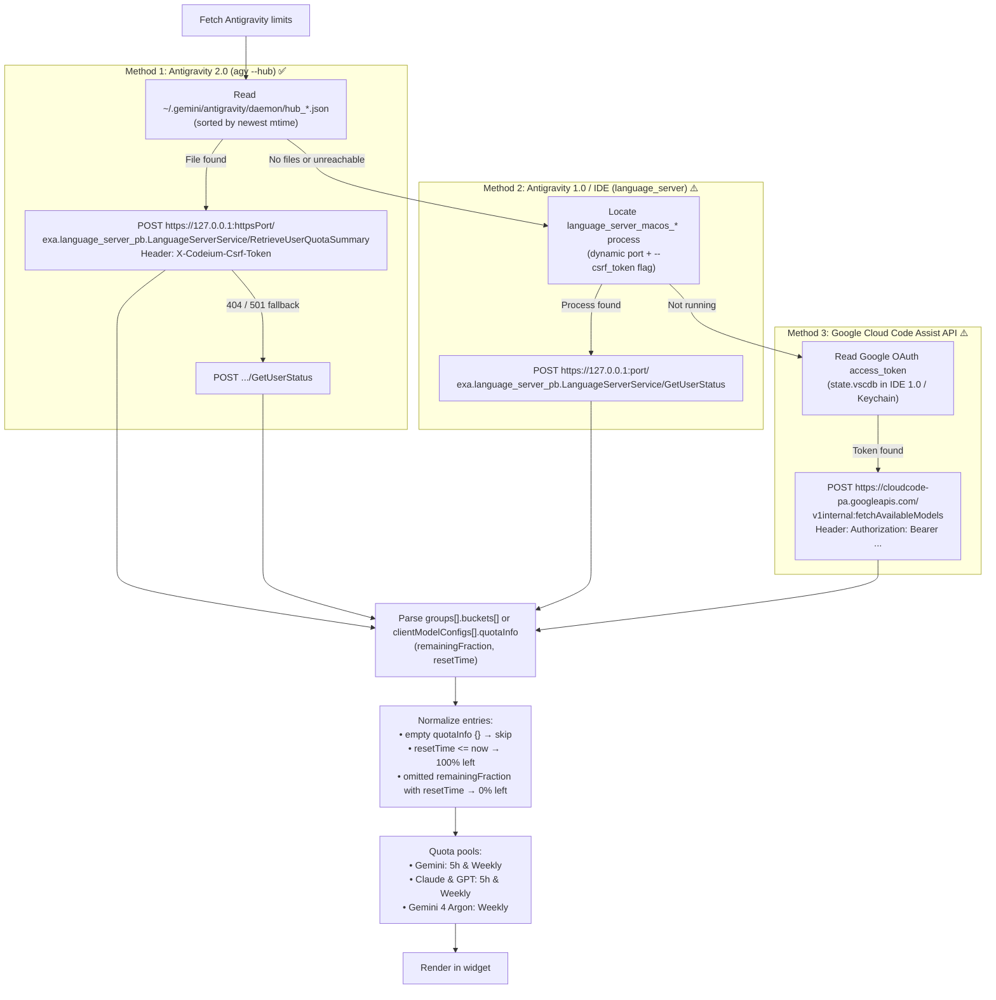

# How to Retrieve Antigravity Limits

Technical reference covering all methods for querying Google Antigravity quotas, response schemas, and limit types.
Status markers: ✅ verified on a live machine (2026-11-19 / 2026-11-20) · ⚠️ from public sources / version-dependent.

---

## 1. Overview Diagram



---

## 2. Retrieval Methods

### Method 1: Local `agy --hub` (Antigravity 2.0) — ✅ verified, used by Limits Widget

Antigravity 2.0 (desktop app and `agy` CLI) runs a background `agy --hub --hub-port=<port>` process and writes connection metadata to `~/.gemini/antigravity/daemon/hub_<port>.json` (mode `0600`).

1. **Discovery:** read `hub_*.json` files in `~/.gemini/antigravity/daemon/`, sorted by descending `mtime` (multiple windows create multiple files; stale files from closed instances fail to connect and are skipped).
   File keys:
   ```json
   {
     "csrfToken": "<REDACTED>",
     "httpPort": 52584,
     "httpsPort": 52583,
     "lsVersion": "...",
     "pid": 27765
   }
   ```
2. **Primary request — all quota groups and `5h` / `weekly` windows (✅ verified 2026-11-20):**
   ```http
   POST https://127.0.0.1:<httpsPort>/exa.language_server_pb.LanguageServerService/RetrieveUserQuotaSummary
   Content-Type: application/json
   Connect-Protocol-Version: 1
   X-Codeium-Csrf-Token: <csrfToken>

   {}
   ```
   Returns `response.groups[]` (`Gemini Models`, `Claude and GPT models`, `Gemini 4 Argon`) with separate `buckets[]` (`window: "5h"` and `"weekly"`, `remainingFraction`, `resetTime`).

   **Fallback request for older hub builds — `GetUserStatus` (✅ verified 2026-11-19):**
   ```http
   POST https://127.0.0.1:<httpsPort>/exa.language_server_pb.LanguageServerService/GetUserStatus
   Content-Type: application/json
   Connect-Protocol-Version: 1
   X-Codeium-Csrf-Token: <csrfToken>

   {"metadata":{"ideName":"antigravity","extensionName":"antigravity","locale":"en"}}
   ```
   - Uses a self-signed TLS certificate on loopback (trust **strictly** for `127.0.0.1`, disable redirects).
   - If `httpsPort` is missing or `0`, fall back to `http://127.0.0.1:<httpPort>`.

**Pros:** no internet calls, no Google OAuth or Keychain prompts, instant response, tokens do not expire.
**Cons:** requires Antigravity / `agy --hub` to be running (when closed, the widget keeps the last snapshot marked `stale`).

---

### Method 2: Local `language_server` (Antigravity 1.0 / IDE) — ⚠️

Older VS Code-based Antigravity IDE builds run `language_server_macos_arm` / `language_server_macos_x64` instead of `agy --hub`.

1. **Discovery:** locate the process via `ps` / `lsof`, extract its listening `127.0.0.1` port and `--csrf_token` argument.
2. **Request:** same RPC endpoint `POST /exa.language_server_pb.LanguageServerService/GetUserStatus` (or `RetrieveUserQuotaSummary`) with `X-Codeium-Csrf-Token`.

**Pros:** local, no OAuth.
**Cons:** absent in Antigravity 2.0; parsing `ps` arguments is fragile.

---

### Method 3: Cloud Code Assist API — ⚠️

Direct backend request used by Antigravity clients:

```http
POST https://cloudcode-pa.googleapis.com/v1internal:fetchAvailableModels
Authorization: Bearer <google_oauth_access_token>
Content-Type: application/json
Accept-Encoding: gzip
User-Agent: antigravity/hub/<version> darwin/arm64

{}
```
*(Candidate/staging builds also use `daily-cloudcode-pa.googleapis.com`; `Accept-Encoding: gzip` is required or the server may return a truncated catalog.)*

**Where OAuth tokens live:**
- IDE 1.0: SQLite `~/Library/Application Support/Antigravity/User/globalStorage/state.vscdb` (`ItemTable`, keys like `antigravityUnifiedStateSync.oauthToken`) or Keychain `Antigravity Safe Storage`.
- Antigravity 2.0: `state.vscdb` **does not exist** (only `credential-user-scope` is present), and no plain JSON OAuth token is stored in Keychain ✅.

**Pros:** can work while Antigravity is closed.
**Cons:** Google OAuth `access_token` expires in ~1 hour (without token refresh it quickly becomes invalid); no clean read-only token file in Antigravity 2.0; undocumented `v1internal:*` API.

---

### Comparison

| Criterion | 1. `agy --hub` (`daemon/hub_*.json`) | 2. IDE `language_server` | 3. Cloud API (`cloudcode-pa`) |
|---|---|---|---|
| Antigravity version | Antigravity 2.0 (`agy`) ✅ | Antigravity 1.0 / IDE | Any (with valid token) |
| External network | No (`127.0.0.1`) | No (`127.0.0.1`) | Yes (`*.googleapis.com`) |
| OAuth token needed | No (local CSRF only) | No (local CSRF only) | Yes (~1h expiry) |
| Works when app is closed | No (widget keeps cached `stale` data) | No | Yes (until token expires) |
| Reliability | High ✅ | Medium | Low (without refresh) |

---

## 3. All Antigravity Limit Types

### Structured quota pools (`RetrieveUserQuotaSummary`, ✅ verified 2026-11-20)

| Group | Window | `bucketId` | Models Sharing This Pool |
|---|---|---|---|
| **Gemini Models** | 5-hour (`5h`) | `gemini-5h` | Gemini 4 Neon, Gemini 4 Hydrogen, Orchestrator (Neon), Gemini 3.8 Flash |
| **Gemini Models** | Weekly (`weekly`) | `gemini-weekly` | Same Gemini pool (individual tier weekly cap) |
| **Claude and GPT models** | 5-hour (`5h`) | `3p-5h` | Claude Opus 5.5, Claude Sonnet 5.5, GPT-OSS 120B |
| **Claude and GPT models** | Weekly (`weekly`) | `3p-weekly` | Same third-party model pool |
| **Gemini 4 Argon** | Weekly (`weekly`) | `gemini-argon-wtu-weekly` | Gemini 4 Argon, Orchestrator (Argon) (separate pool on Pro plans; included in Gemini bucket on Ultra) |
| **Free / Starter tier** ⚠️ | Weekly (`weekly`) | — | Weekly reset only (no 5-hour rolling window) |
| **Unmetered / Experimental** | None | — | e.g. `Gemini 4 Carbon` (`"quotaInfo": {}` in `GetUserStatus`) |

### Edge Cases in `quotaInfo` / `buckets[]`

| Payload Shape | Meaning | Handling |
|---|---|---|
| `{"remainingFraction": 0.97, "resetTime": "..."}` | Active window | Remaining = `remainingFraction * 100%`, used = `(1 - remainingFraction) * 100%` |
| `{"resetTime": "..."}` (no `remainingFraction`) | **Exhausted (0% left)** — protobuf v3 omits zero floats in JSON | Treat `remainingFraction` as `0.0` (100% used) |
| `resetTime <= now` | Window already reset | Treat `remainingFraction` as `1.0` (0% used) |
| `{}` (neither field present) | Model without tracked quota | **Skip**, do not treat as 0% |

### Personal Data (PII)
`GetUserStatus` includes `email`, `name`, and `profilePictureUrl` — **never decode, log, or store** these fields.

---

## 4. Safe Terminal Verification (No Secrets Printed)

```bash
f=$(ls -t ~/.gemini/antigravity/daemon/hub_*.json | head -n 1)
port=$(jq -r '.httpsPort // .httpPort' "$f")
csrf=$(jq -r '.csrfToken' "$f")
curl -sk -X POST "https://127.0.0.1:${port}/exa.language_server_pb.LanguageServerService/RetrieveUserQuotaSummary" \
  -H "Content-Type: application/json" \
  -H "Connect-Protocol-Version: 1" \
  -H "X-Codeium-Csrf-Token: ${csrf}" \
  -d '{}' \
  | jq 'del(.email, .name, .userId, .accountId)'
```
