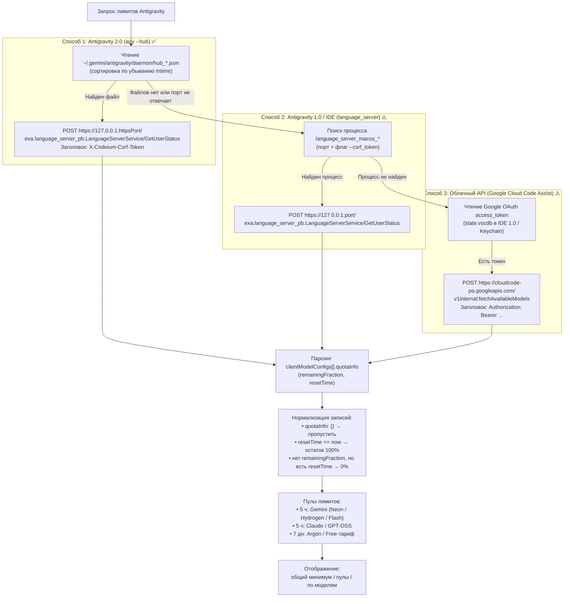

# Схема получения лимитов Antigravity

Справочник по всем способам получения квот Google Antigravity, структуре ответов и видам лимитов.
Обозначения: ✅ — проверено на реальной машине (2026-11-19) · ⚠️ — из открытых источников / зависит от версии.

---

## 1. Общая схема получения лимитов



---

## 2. Все способы получения лимитов

### Способ 1. Локальный `agy --hub` (Antigravity 2.0) — ✅ проверен, используется в виджете

Antigravity 2.0 (desktop-приложение и CLI `agy`) запускает фоновый процесс `agy --hub --hub-port=<port>` и сохраняет параметры подключения в `~/.gemini/antigravity/daemon/hub_<port>.json` (права `0600`).

1. **Обнаружение:** прочитать `hub_*.json` в `~/.gemini/antigravity/daemon/`, отсортировать по убыванию `mtime` (если открыто несколько проектов — файлов несколько; старые файлы от закрытых окон отсеиваются при ошибке соединения).
   Ключи файла:
   ```json
   {
     "csrfToken": "<REDACTED>",
     "httpPort": 52584,
     "httpsPort": 52583,
     "lsVersion": "...",
     "pid": 27765
   }
   ```
2. **Запрос (основной — все пулы и окна `5h` / `weekly`, ✅ проверено 2026-11-20):**
   ```http
   POST https://127.0.0.1:<httpsPort>/exa.language_server_pb.LanguageServerService/RetrieveUserQuotaSummary
   Content-Type: application/json
   Connect-Protocol-Version: 1
   X-Codeium-Csrf-Token: <csrfToken>

   {}
   ```
   Возвращает `response.groups[]` (`Gemini Models`, `Claude and GPT models`, `Gemini 4 Argon`) с отдельными `buckets[]` (`window: "5h"` и `"weekly"`, `remainingFraction`, `resetTime`).

   **Запрос (фоллбэк для старых версий — `GetUserStatus`, ✅ проверено 2026-11-19):**
   ```http
   POST https://127.0.0.1:<httpsPort>/exa.language_server_pb.LanguageServerService/GetUserStatus
   Content-Type: application/json
   Connect-Protocol-Version: 1
   X-Codeium-Csrf-Token: <csrfToken>

   {"metadata":{"ideName":"antigravity","extensionName":"antigravity","locale":"en"}}
   ```
   - Используется локальный самоподписанный TLS-сертификат (доверять ему **строго** для `127.0.0.1`, редиректы запрещены).
   - Если `httpsPort` отсутствует или `0`, используется `http://127.0.0.1:<httpPort>`.

**Плюсы:** без внешней сети, без Google OAuth и Keychain, мгновенный ответ, токены не протухают.
**Минусы:** работает только пока запущен Antigravity / `agy --hub`.

---

### Способ 2. Локальный `language_server` (Antigravity 1.0 / IDE) — ⚠️

В ранних/IDE-версиях Antigravity (на базе VS Code) вместо `agy --hub` запускается процесс `language_server_macos_arm` / `language_server_macos_x64`.

1. **Обнаружение:** поиск процесса через `ps` / `lsof`, извлечение динамического порта на `127.0.0.1` и аргумента `--csrf_token`.
2. **Запрос:** тот же RPC-метод `POST /exa.language_server_pb.LanguageServerService/GetUserStatus` (или `RetrieveUserQuotaSummary`) с заголовком `X-Codeium-Csrf-Token`.

**Плюсы:** локальный, без OAuth.
**Минусы:** в Antigravity 2.0 этого процесса уже нет; парсинг аргументов `ps` хрупкий.

---

### Способ 3. Облачный API Google Cloud Code Assist — ⚠️

Прямой запрос к бэкенду Google, которым пользуются IDE и CLI:

```http
POST https://cloudcode-pa.googleapis.com/v1internal:fetchAvailableModels
Authorization: Bearer <google_oauth_access_token>
Content-Type: application/json
Accept-Encoding: gzip
User-Agent: antigravity/hub/<version> darwin/arm64

{}
```
*(В staging/candidate-сборках также встречается хост `daily-cloudcode-pa.googleapis.com`; важно передавать `Accept-Encoding: gzip`, иначе сервер может вернуть урезанный каталог.)*

**Где ищут OAuth-токен:**
- В IDE 1.0: SQLite `~/Library/Application Support/Antigravity/User/globalStorage/state.vscdb` (таблица `ItemTable`, ключи `*antigravity*` / `antigravityUnifiedStateSync.oauthToken`) или Keychain `Antigravity Safe Storage`.
- В Antigravity 2.0: `state.vscdb` **отсутствует** (в `~/Library/Application Support/Antigravity/` лежит только `credential-user-scope`), а в Keychain открытого JSON-токена нет ✅.

**Плюсы:** теоретически работает даже при закрытом Antigravity.
**Минусы:** Google OAuth `access_token` живёт ~1 час (без refresh-запросов быстро истекает); в Antigravity 2.0 нет простого read-only источника токена; внутренний недокументированный эндпоинт `v1internal:*`.

---

### Сравнение способов

| Критерий | 1. `agy --hub` (`daemon/hub_*.json`) | 2. IDE `language_server` | 3. Облачный API (`cloudcode-pa`) |
|---|---|---|---|
| Версия Antigravity | Antigravity 2.0 (`agy`) ✅ | Antigravity 1.0 / IDE | Любая (при наличии токена) |
| Выход в интернет | Нет (`127.0.0.1`) | Нет (`127.0.0.1`) | Да (`*.googleapis.com`) |
| Нужен OAuth-токен | Нет (только локальный CSRF) | Нет (только локальный CSRF) | Да (истекает ~через 1 ч) |
| Работает при закрытом приложении | Нет (виджет держит кэш «данные устарели») | Нет | Да (пока жив токен) |
| Надёжность | Высокая ✅ | Средняя | Низкая (без refresh) |

---

## 3. Все виды лимитов Antigravity

В отличие от Claude Code и Codex (где лимиты привязаны к общим окнам «5 ч» и «Неделя»), Antigravity возвращает квоты **по каждой модели** в массиве `userStatus.cascadeModelConfigData.clientModelConfigs[]`:

```json
{
  "label": "Gemini 4 Neon (High)",
  "quotaInfo": {
    "remainingFraction": 0.9645665,
    "resetTime": "2026-11-20T02:12:51Z"
  }
}
```

### Типы квотных пулов (по реальному ответу `GetUserStatus`, 2026-11-19 ✅)

Модели внутри одного пула делят **общий** `remainingFraction` и **общее** `resetTime`:

| Тип окна | Пул моделей | Примеры моделей в `clientModelConfigs` | Период сброса |
|---|---|---|---|
| **Короткое скользящее окно (5 ч)** | **Gemini (основной пул)** | Gemini 4 Neon (Low/Medium/High/XHigh), Gemini 4 Hydrogen (Low/Medium/High/XHigh), Gemini 3.8 Flash (Low/Medium/High), Orchestrator (Neon) | ~5 часов (Pro / Ultra) |
| **Короткое скользящее окно (5 ч)** | **Сторонние модели** | Claude Opus 5.5 (Low/Medium/High), Claude Sonnet 5.5 (Low/Medium/High), GPT-OSS 120B (Medium) | ~5 часов (Pro / Ultra) |
| **Недельное окно (7 дн)** | **Тяжёлые / флагманские модели** | Gemini 4 Argon (Low/Medium/High), Orchestrator (Argon) | 7 дней |
| **Недельное окно (7 дн)** | **Free / Starter тариф** ⚠️ | Все доступные модели | 7 дней (на бесплатном тарифе 5-часового окна нет) |
| **Без квоты** | **Нетарифицируемые / экспериментальные** | Gemini 4 Carbon (`"quotaInfo": {}`) | Нет (`remainingFraction` и `resetTime` отсутствуют) |

### 4 состояния объекта `quotaInfo` (крайние случаи)

| Что пришло в `quotaInfo` | Смысл | Как обрабатывать |
|---|---|---|
| `{"remainingFraction": 0.85, "resetTime": "..."}` | Активное окно | Остаток = `remainingFraction * 100%`, использовано = `(1 - remainingFraction) * 100%` |
| `{"resetTime": "..."}` (без `remainingFraction`) | **Лимит исчерпан (0%)** — особенность protobuf v3, где `0.0` опускается при сериализации в JSON | Считать `remainingFraction = 0.0` (использовано `100%`) |
| `resetTime <= now` (дата сброса в прошлом) | Окно уже сброшено, но сервер ещё не обновил счётчик | Считать `remainingFraction = 1.0` (остаток `100%`, использовано `0%`) |
| `{}` (нет ни `remainingFraction`, ни `resetTime`) | Модель без отслеживаемой квоты (например, `Gemini 4 Carbon`) | **Пропускать**, не считать 0% |

### Прочие поля `userStatus`

- `planStatus`, `userTier` — информация о тарифе (Free / Google AI Pro / Google AI Ultra).
- `email`, `name`, `profilePictureUrl` — **персональные данные (PII)**: не декодировать, не логировать, не сохранять в фикстуры.

---

## 4. Варианты агрегации для UI

1. **Один общий индикатор (реализовано в `LimitsWidget`):** берётся модель с **минимальным эффективным остатком** среди всех валидных моделей (при равенстве — с ближайшим `resetTime` в будущем). Компактно и сразу показывает самое узкое место.
2. **По пулам моделей (дедупликация):** группировка записей с одинаковой парой `(remainingFraction, resetTime)` — даёт 2–3 строки (например: «Gemini 5 ч», «Claude 5 ч», «Argon 7 дн»).
3. **По каждой модели:** прямой список всех `clientModelConfigs` с непустым `quotaInfo` (20+ строк — подходит для детального окна, но не для компактного виджета).

---

## 5. Быстрая безопасная проверка в терминале (без вывода секретов)

```bash
f=$(ls -t ~/.gemini/antigravity/daemon/hub_*.json | head -n 1)
port=$(jq -r '.httpsPort // .httpPort' "$f")
csrf=$(jq -r '.csrfToken' "$f")
curl -sk -X POST "https://127.0.0.1:${port}/exa.language_server_pb.LanguageServerService/GetUserStatus" \
  -H "Content-Type: application/json" \
  -H "Connect-Protocol-Version: 1" \
  -H "X-Codeium-Csrf-Token: ${csrf}" \
  -d '{"metadata":{"ideName":"antigravity","extensionName":"antigravity","locale":"en"}}' \
  | jq '[.userStatus.cascadeModelConfigData.clientModelConfigs[]? | {label, quotaInfo}]'
```
